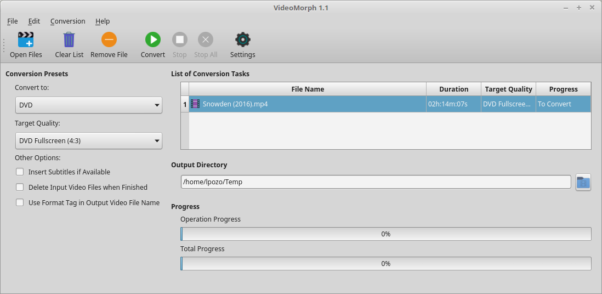

# VideoMorph


[](https://github.com/ellerbrock/open-source-badge/)
[](https://codeclimate.com/github/videomorph-dev/videomorph/maintainability)
[](https://github.com/videomorph-dev/videomorph/pulls)

**VideoMorph** is a **video converter** based on [ffmpeg](http://ffmpeg.org), written with [Python](https://python.org) 3 and [PyQt6](https://www.riverbankcomputing.com/static/Docs/PyQt6/introduction.html). Convert videos to **MPG**, **MP4**, **AVI**, **WEBM**, **DVD**, **VCD**, **FLV**, **MOV**, **OGV**, **WMV**, **MKV**, **Jellyfin-optimized H.264/H.265**, and audio to **MP3** or **OGA**.

VideoMorph is a video converter, just that. Consists on a GUI wrapper for [Ffmpeg](http://ffmpeg.org), based on general ideas from [python-video-converter](https://github.com/senko/python-video-converter), and presets idea from [QWinFF](http://qwinff.github.io). If you're looking for a video editor, we're sorry but VideoMorph isn't for you.

- [VideoMorph](#videomorph)
  - [GUI Screenshot](#gui-screenshot)
  - [Requirements](#requirements)
  - [Installation](#installation)
    - [Installing From the Binary Packages](#installing-from-the-binary-packages)
      - [On GNU/Linux](#on-gnulinux)
      - [On Windows](#on-windows)
    - [Installing Form the Source Packages](#installing-form-the-source-packages)
      - [On GNU/Linux](#on-gnulinux-1)
      - [On Windows](#on-windows-1)
    - [Using Portable Editions (if available)](#using-portable-editions-if-available)
  - [How to Contribute to the Source](#how-to-contribute-to-the-source)
    - [Setting up the Development Environment](#setting-up-the-development-environment)
    - [Commits](#commits)
    - [Internal Contributions Procedure](#internal-contributions-procedure)
    - [External Contributions Procedure](#external-contributions-procedure)
    - [Branch Naming Conventions](#branch-naming-conventions)
    - [Coding, and Docstrings Style](#coding-and-docstrings-style)
    - [Commit Messaging Style](#commit-messaging-style)
  - [Licensing](#licensing)
  - [Authors and Contributors](#authors-and-contributors)
  - [Copyright](#copyright)

## GUI Screenshot



## Requirements

VideoMorph uses the following libraries and programs:

- [PyQt6](https://www.riverbankcomputing.com/static/Docs/PyQt6/introduction.html) >= 6.4
- [FFmpeg](http://ffmpeg.org)
- [Python](https://python.org) >= 3.11

You need to install these programs and libraries for VideoMorph to work properly.

## Installation

You can install and use VideoMorph on GNU/Linux and on Windows systems. There are several ways you can use to install the application. Let's take a look at them. We haven't tried properly **yet** on macOS :-|

### Installing From the Binary Packages

If you're using GNU/Linux or Windows, then you can install VideoMorph by using the appropriate binary package for your system.

#### On GNU/Linux

You can install VideoMorph on Debian/Ubuntu and derivatives by running the following steps:

1. Download the `.deb` package

2. Open a terminal, and run the following commands as **root** or using **sudo**:

```sh
$ sudo apt install ffmpeg python3 python3-pyqt6
$ cd <directory containing VideoMorph binary>
$ sudo dpkg -i videomorph_x.x_all.deb
```

That should be enough to get VideoMorph (and its dependencies) installed on your system.

You can also install VideoMorph's `.deb` package, by using GDebi, which is a GUI Packages Installer that will manage the dependencies for you.

#### On Windows

To install VideoMorph on your Windows system, you can:

1. Download the installer that corresponds to your architecture

2. Run the installer as an `administrator`

3. Follow on-screen instructions

### Installing Form the Source Packages

You can install VideoMorph from the source packages. Let's take a look at how to do this.

#### On GNU/Linux

To install the application from the source package on a GNU/Linux system, do the following:

1. Download the `.tar.gz` package
2. Open a terminal, and type in this:

```bash
$ tar -xvf videomorph-x.x.tar.gz
$ cd videomorph-x.x
$ sudo pip3 install -r requirements.txt
$ python3 setup.py build
$ sudo python3 setup.py install
```

The preceding commands will install VideoMorph, and part of its dependencies into your system. To complete the installation, you need to manually install Ffmpeg or use the Ffmpeg's packages from your distro's current repository.

**Note:** If you install Ffmpeg from its sources, then you need to make sure that the commands `ffmpeg`, and `ffprobe` are in your system's PATH. To verify this, just run the following commands:

```bash
$ which ffmpeg
/usr/bin/ffmpeg
$ which ffprobe
/usr/bin/ffprobe
```

If you don't get a similar output, then you need to check your Ffmpeg installation.

On Debian/Ubuntu derivatives, you can also install VideoMorph by using the `install.sh`  script provided in the source package as **root** or using **sudo**:

```bash
$ tar -xvf videomorph-x.x.tar.gz
$ cd videomorph-x.x
$ sudo ./install.sh
```

This command will install VideoMorph, and its dependencies, (Ffmpeg, and PyQt6), from your distro's current repository.

#### On Windows

To install VideoMorph from the source package on your Windows system, first, make sure you have Python3 installed, then run the following steps:

1. Download and decompress the `.zip` source package
2. Open your Windows' command-line (`cmd.exe`), and type the following commands:

```powershell
PS> cd videomorph-x.x
PS> pip install -r requirements.txt
PS> python3 setup.py build
PS> python3 setup.py install
```

This will install VideoMorph on your system, but you'll need to install Ffmpeg manually.

**Note:** It's possible that you have to run the second and the fourth command as an `administrator`.

### Using Portable Editions (if available)

To use a Portable Edition (PE) of VideoMorph, you need to:

1. Download the PE package that matches your current system
2. Decompress the `.tar.gz` or the `.zip` file (Linux and Windows respectively) in any directory
3. Double-click on VideoMorph's executable (`videomorph` or `videomorph.exe`)

## How to Contribute to the Source

If you want to contribute to VideoMorph's development cycle, you can follow the steps described in this section.

Reach out to contribute with:

- Translations
- Artwork and GUI improvements
- Customized conversion profiles or presets
- Tutorials on how to use VideoMorph
- Documentation
- Feature requests
- Bug reports

Any other type of contributions are also welcome, even a report about a typo is very welcome, so it's your turn to talk, but remember: VideoMorph is just a video converter, not a video editor.

### Setting up the Development Environment

```bash
git clone https://github.com/videomorph-dev/videomorph.git
cd videomorph
python3 -m venv venv
source venv/bin/activate   # Windows: venv\Scripts\activate
make dev                    # installs runtime + dev deps
```

You also need `ffmpeg` and `ffprobe` in your PATH.

### Build Commands

All common tasks are available via `make`:

| Command | Description |
|---------|-------------|
| `make dev` | Install runtime + dev dependencies |
| `make test` | Run tests with coverage report |
| `make lint` | Check code style with ruff |
| `make format` | Auto-format code with ruff |
| `make qrc` | Regenerate Qt resources from `qrc/` |
| `make build` | Build sdist + wheel |
| `make deb` | Build Debian `.deb` package (Linux only) |
| `make exe` | Build standalone executable (PyInstaller) |
| `make clean` | Remove all build artifacts |

### Regenerating Qt Resources

After adding or modifying icons/images in `qrc/`:

```bash
make qrc
```

This runs `pyrcc5` and patches the import from `PyQt5` to `PyQt6`.

### Creating a Release

Push a version tag to trigger the release CI:

```bash
git tag v1.6
git push origin v1.6
```

The release workflow builds and publishes:
- Source tarball (`.tar.gz`) — all platforms
- Debian package (`.deb`) — Ubuntu/Debian
- Windows standalone (`.zip`) — Windows x64
- macOS app bundle (`.zip`) — macOS 13+

### Commits

The members of the VideoMorph Development Team that can commit changes into the repo are:

- [Ozkar L. Garcell](https://github.com/codeshard)
- [Leodanis Pozo Ramos](https://github.com/lpozo)
- [Leonel Salazar Videaux](https://github.com/leonel-lordford)

### Internal Contributions Procedure

1. Work on new features, bug fixes, and other changes on a separated local branch
2. Once the work is done, `push` the whole branch to the `videomorph-dev` repo
3. Create a Pull Request (PR) targeting the `develop` branch
4. Wait for review, feedback, and approval
5. Merge the approved PR into the `develop` branch
6. Delete the temporarily branch

**Note:** The preceding procedure is intended to be used by the members of the VideoMorph Development Team.

### External Contributions Procedure

External contributors must:

- Fork the repo on GitHub
- Work on modifications
- Push modifications to the forked repo
- Make a PR targeting the main VideoMorph `develop` branch
- Wait for review, feedback, and approval

### Branch Naming Conventions

The name for a branch will be like:

```
username_i000_topic
```

Where:

- `username` corresponds to the GitHub username
- `i000` represents the issue number the branch is dealing with. If there is no issue to map the branch then `i000` will be used
- `topic`, stands for a descriptive name that reflects the main goal of the branch (e.g: `john_i024_feature_mov_format`)

### Coding, and Docstrings Style

- VideoMorph's code will follow the coding style guidelines described in [PEP8](https://www.python.org/dev/peps/pep-0008/)
- Docstrings in VideoMorph's code will follow the guidelines described in [PEP257](https://www.python.org/dev/peps/pep-0257/)
- Tools like `pylint`, `pep8`, `flake`, and others can be used to ensure that coding style guides are met

### Commit Messaging Style

General rules for writing commit messages:

1. Separate subject from body with a blank line
2. Limit the subject line to 50 characters
3. Capitalize the subject line
4. Do not end the subject line with a period
5. Use the imperative mood in the subject line
6. Wrap the body at 72 characters
7. Use the body to explain what and why vs how
```

Add support for MOV format

Add support for MOV format with several presets to give more 
default conversion options to the user.
```

Keep in mind that not all commits require an explanatory body, sometimes with the subject line is enough.

For more details see: [How to Write a Git Commit Message](https://chris.beams.io/posts/git-commit/)

## Licensing

VideoMorph is licensed under [Apache License Version 2.0](http://www.apache.org/licenses/).

Following the idea of [python-video-converter](https://github.com/senko/python-video-converter), VideoMorph only uses the Ffmpeg binaries, so it doesn't need to be licensed under LGPL/GPL.

## Authors and Contributors

Authors:

- [Ozkar L. Garcell](mailto:ozkar.garcell@gmail.com)
- [Leodanis Pozo Ramos](mailto:lpozor78@gmail.com)

Contributors:
- [Leonel Salazar Videaux](http://debianhlg.cubava.cu/)
- [Maikel Llamaret Heredia](http://gutl.jovenclub.cu) **[Rest in peace dear friend.]**
- [Carlos Parra Zaldivar](http://libreoffice.cubava.cu) **[Rest in peace dear friend.]**
- Osmel Cruz

## Copyright

Copyright 2016-2022 VideoMorph Development Team.
